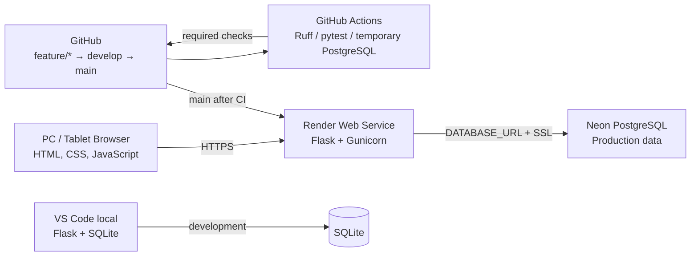
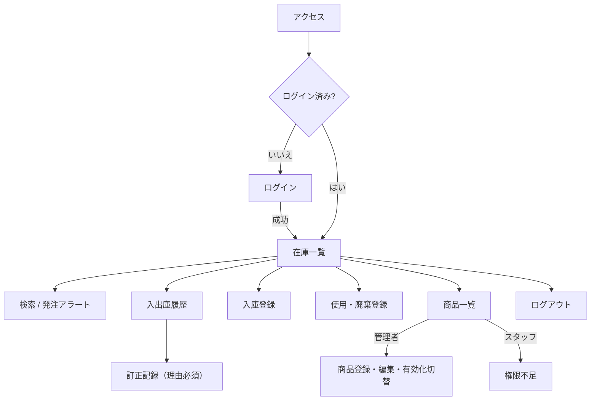
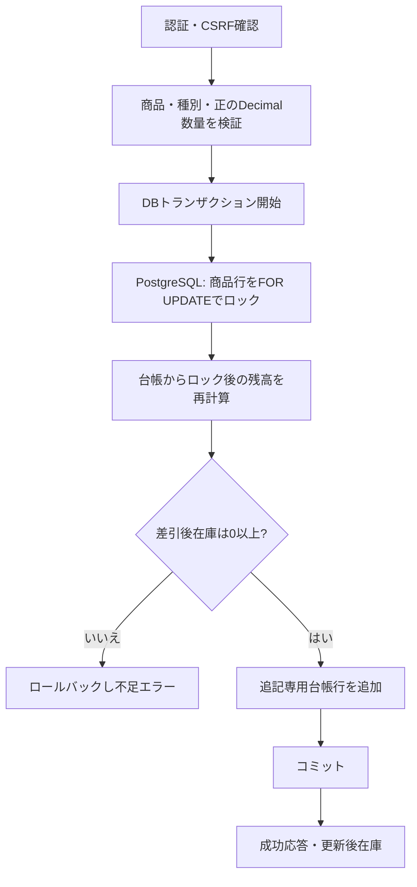

# システム設計

## 構成

本番の秘密値はRenderの環境変数だけに置く。自動デプロイはGitHub Actionsのチェック成功後に限定する。DBマイグレーションはWebプロセス起動時に暗黙実行せず、承認済みのリリース操作として行う。

## アプリケーション層

- Application Factory が設定、SQLAlchemy、Migrate、ログイン管理、CSRFを初期化する。
- Routes は入力検証、認証・権限検査、サービス呼出し、画面応答を担う。
- Services は在庫操作・トランザクション境界・残高制約を担う。
- Models はユーザー、商品、追記専用在庫移動を定義する。
- Templates / static はJinja2と通常のHTML/CSS/JavaScriptを使う。追加フロントエンドフレームワークは採用しない。

## 画面遷移

## 入出庫フロー

SQLiteはローカル単体テスト用であり、PostgreSQLの行ロック意味論を再現しない。実際の同時出庫テストはCIのPostgreSQLサービスで実行する。PostgreSQLの行ロックはトランザクション内で保持し、残高読取はロック取得後に行う。
