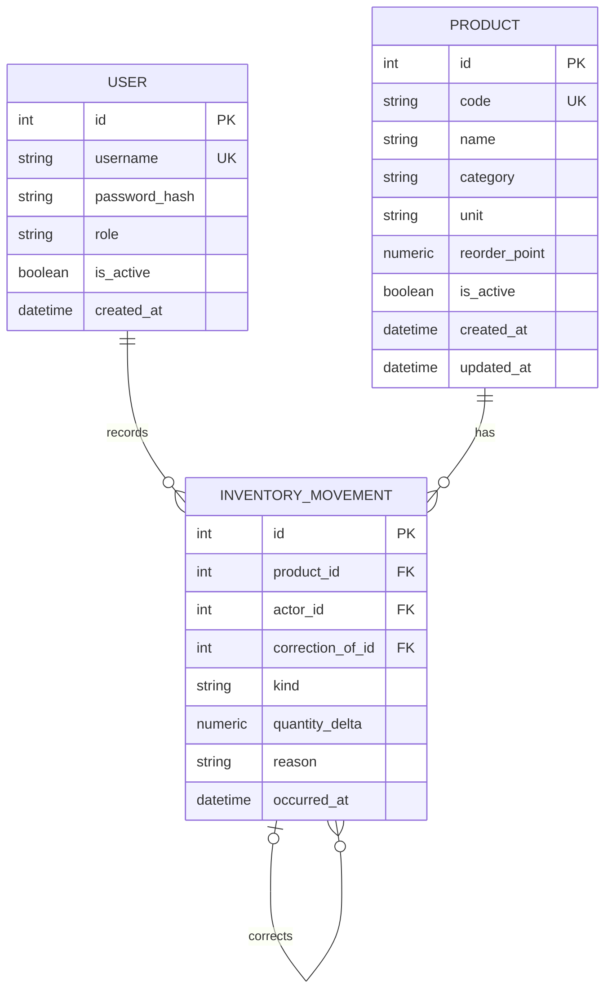

# データベース設計

## ER図

## テーブル・制約

- `user`: 一意なユーザー名、パスワードハッシュ、`admin` / `staff` ロール、有効状態。公開登録は提供しない。
- `product`: 一意な商品コード、商品名、カテゴリ、単位、非負 `NUMERIC(12,3)` 発注点、有効状態。削除せず無効化する。
- `inventory_movement`: 追記専用の在庫台帳。商品・操作者への外部キー、移動種別、符号付き `NUMERIC(12,3)` 差分、記録日時を持つ。訂正行は `correction_of_id` で元移動を参照し、理由を必須にする。
- 移動種別は `receipt`, `usage`, `waste`, `correction`。入庫差分は正、使用・廃棄差分は負。訂正差分は正負いずれも可能。
- `quantity_delta` は0不可。DBチェック制約に加え、サービス層で種別と符号の整合性を検証する。
- 商品コード・ユーザー名に一意制約を付与する。商品名・カテゴリ検索用インデックスと移動履歴の `(product_id, occurred_at)` / `(occurred_at)` インデックスを設ける。
- DB制約だけでは履歴合計が負にならないことを保証できないため、商品行ロックとトランザクション内残高検証を必須とする。

## 在庫計算・訂正

現在庫は `SUM(inventory_movement.quantity_delta)` として計算する。初期在庫も入庫移動で記録し、別の在庫数キャッシュは持たない。発注アラートは現在庫 `<= reorder_point`。

訂正は元行を更新・削除せず、元の記録を参照する訂正差分を追記する。たとえば入庫を2単位減らす場合は `-2.000` の訂正行を作る。訂正は理由を必須とし、訂正後残高が0未満なら拒否する。全件の履歴を維持する。

## トランザクションと環境

PostgreSQLでは商品行を `SELECT ... FOR UPDATE` でロックしてから台帳を合計し、書込みを行う。台帳挿入と残高検証は同一トランザクションとする。SQLiteのロック動作を本番同等の根拠にしない。

ローカル・単体テストはSQLite。CI統合テストは使い捨てPostgreSQL。Neonは本番専用であり、自動テスト・初期化・fixture投入を行わない。スキーマ変更はAlembicマイグレーションに記録する。
